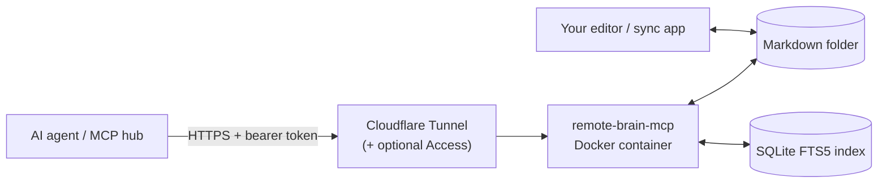

<div align="center">

# remote-brain-mcp

**Your Markdown notes, safely reachable for AI agents – from anywhere, hosted by you.**

[](https://github.com/jnbp/remote-brain-mcp/actions/workflows/docker.yml)
[](LICENSE)


</div>

remote-brain-mcp is a small, self-hosted [MCP](https://modelcontextprotocol.io) server for **one
folder of Markdown notes** – your "second brain" or vault. It runs as a Docker container right next
to your files (for example on a NAS), and any MCP client or MCP hub can reach it over HTTPS. Your
notes stay plain Markdown files in the folder you already use, edited with whatever app you like.



## At a glance

| | |
|---|---|
| 🔎 **Fast full-text search** | SQLite FTS5 index, ranked results in milliseconds; accent- and case-insensitive, phrases, prefixes, substrings. |
| ✍️ **Precise, safe edits** | Replace one passage, edit the text under a heading, append, rewrite – guarded by SHA-256, so a note that changed meanwhile is never overwritten. |
| 🔗 **Links stay intact** | Moving or renaming a note updates every `[[wikilink]]` to it, also in frontmatter; ambiguous cases are reported, never guessed. |
| 🗑️ **Nothing is deleted directly** | Items go to a trash folder inside your vault, can be restored, and expire after 90 days (configurable). |
| 🧭 **Vault aware** | Resolves `[[wikilinks]]`, lists backlinks, queries YAML frontmatter. |
| 🔒 **Hard boundary** | Full access inside the mounted folder, nothing outside it. Symlinks are never followed; exclusions are enforced for every tool. |
| 🪶 **Light** | No AI models, no outbound connections, no web UI, under 256 MB RAM – fits a home NAS. |

## What an agent can do with it

> *"Find my notes about the heating repair and summarise what is still open."*
> → `search` → `read_note`

> *"Add today's decision to the Decisions section of the project note."*
> → `read_note` → `edit_section(mode="append")`

> *"Rename 'Alpha' to 'Project Alpha' and move it to Archive."*
> → `move_note` – every link to it is updated.

> *"Which projects are still active?"*
> → `find_by_frontmatter({"type": "Project", "status": "Active"})`

## Why not a file-sharing API?

Generic NAS integrations (for example through the Synology File Station API) can only download and
upload whole files, their search usually matches file names only, and sessions expire. For working
with notes this means slow searches (every file has to be downloaded on each search), whole-file
overwrites without conflict detection, and broad credentials for the whole NAS. This server runs
next to the files, keeps a search index, and only ever sees the one folder you mount.

## Quick start (Docker Compose)

Two compose files are provided:

- [`compose.cloudflare.yaml`](compose.cloudflare.yaml) – **recommended** if you use Cloudflare:
  the server plus its own tunnel connector on a private Docker network. No port is opened on your
  machine or LAN.
- [`compose.yaml`](compose.yaml) – the server alone, for your own reverse proxy or tunnel.

1. Create a folder for the project, e.g. `remote-brain-mcp/`, and put the compose file you chose
   (named `compose.yaml`) and a copy of [`.env.example`](.env.example) named `.env` into it.
2. Create a `data` folder for the index (owned by the same user as your notes).
3. Fill in `.env`:
   - `VAULT_PATH` – absolute path to your notes folder
   - `DATA_PATH` – absolute path to the `data` folder
   - `PUID` / `PGID` – user and group that own your notes
   - `RB_TOKEN` – a long random secret, e.g. `openssl rand -hex 32` (the server refuses the
     placeholder and anything shorter than 32 characters)
   - `RB_ALLOWED_HOSTS` – **must include the public host name** your tunnel or proxy uses,
     otherwise requests are refused
   - `RB_PUBLISH` – only for `compose.yaml`: where the port is published (see below)
   - `CLOUDFLARE_TUNNEL_TOKEN` – only for `compose.cloudflare.yaml`
4. `docker compose up -d`. The log shows `index ready: <n> notes`; `/health` answers `ok`.
5. Add the server to your MCP client (see [Connecting a client](#connecting-a-client)).

### Synology (Container Manager)

1. In File Station create e.g. `docker/remote-brain-mcp/` and inside it a `data` folder, using the
   account that owns your notes.
2. Upload `compose.yaml` and your filled-in `.env` to `docker/remote-brain-mcp/`.
   Paths use the volume form, e.g. `VAULT_PATH=/volume1/homes/<user>/Notes`.
3. Find your UID: Control Panel does not show it; it is usually `1026` or higher for the first user.
   The group `users` is `100`.
4. Container Manager → Project → Create → choose the folder, keep the existing `compose.yaml`, build.
5. To update later: pull the new image and rebuild the project.

### Building the image yourself

The compose files use the published image `ghcr.io/jnbp/remote-brain-mcp`. To build locally
instead: `docker build -t remote-brain-mcp .` and set `image: remote-brain-mcp` in your compose file.

## Exposing it safely

The server is meant to be reached through a tunnel or reverse proxy with HTTPS. A setup that works
well:

1. **Cloudflare Tunnel:** with `compose.cloudflare.yaml`, create a tunnel in the Cloudflare
   dashboard, put its token into `.env`, and add a public host name (e.g. `notes.example.com`)
   pointing to `http://remote-brain-mcp:8080`. With an existing connector elsewhere, use
   `compose.yaml` and set `RB_PUBLISH` to a port that connector can reach (e.g. `8765`); note
   that this exposes plain HTTP on your LAN, still protected by the token.
2. **Bearer token:** every request to `/mcp` needs `Authorization: Bearer <RB_TOKEN>`.
3. **Recommended second layer – Cloudflare Access:** create an Access application for the host
   name with a *Service Auth* policy and a service token. Requests without
   `CF-Access-Client-Id` and `CF-Access-Client-Secret` are blocked by Cloudflare and never reach
   your machine.

`/health` needs no token and returns only `ok`. Requests carrying an `Origin` header (browsers)
are refused unless the origin is listed in `RB_ALLOWED_ORIGINS`.

## Connecting a client

Endpoint: `https://notes.example.com/mcp` (Streamable HTTP).

Example for an MCP hub or client that accepts a JSON server definition:

```json
{
  "remote-brain": {
    "type": "streamable-http",
    "url": "https://notes.example.com/mcp",
    "headers": {
      "Authorization": "Bearer <RB_TOKEN>",
      "CF-Access-Client-Id": "<service token id>",
      "CF-Access-Client-Secret": "<service token secret>"
    }
  }
}
```

Leave out the two `CF-Access-*` headers if you do not use Cloudflare Access.

## Tools

| Tool | What it does |
|---|---|
| `get_status` | Note count, index age, skipped files, trash size, version. |
| `list_folder` | List a folder (optionally recursive). Types: `note`, `file`, `folder`. |
| `read_note` | Read a note or a range of lines. Returns `sha256` of the whole file and `complete`. |
| `search` | Full-text search. `mode="words"` (default) or `"substring"`, optional `path_prefix`. |
| `resolve_link` | Find the note a `[[wikilink]]` points to; reports ambiguous names. |
| `get_backlinks` | Notes that link to a note, with the linking line. |
| `find_by_frontmatter` | Find notes by frontmatter, e.g. `{"type": "Project", "status": "Active"}`. |
| `create_note` | Create a note (never overwrites). |
| `edit_note` | Replace exactly one passage; needs `expected_sha256` by default. |
| `append_to_note` | Append text. |
| `edit_section` | Replace, append to or prepend to the text under a heading (`Status` or `## Status`). |
| `replace_note` | Rewrite a whole note; needs `expected_sha256`. |
| `move_note` | Move or rename a note, file or folder (never overwrites); updates links to it. |
| `move_to_trash` | Move a note, file or folder to the trash. |
| `list_trash` | List trash items with expiry dates. |
| `restore_from_trash` | Restore an item to its original place or a new path. |

Search syntax in `words` mode: plain words (all must match), `"exact phrase"`, `prefix*`.
Errors come back as JSON with a stable `error` code, e.g. `conflict`, `not_found`, `outside_vault`.

## Configuration

| Variable | Default | Meaning |
|---|---|---|
| `RB_TOKEN` / `RB_TOKEN_FILE` | – | Required. Bearer token (min. 32 characters), or a file containing it. |
| `RB_ALLOWED_HOSTS` | `localhost,127.0.0.1` | Host names the server answers to. Add your public host name. |
| `RB_ALLOWED_ORIGINS` | – | Origins allowed for browser-based clients. Server-side clients need nothing. |
| `RB_VAULT_PATH` | `/vault` | Notes folder inside the container. |
| `RB_DATA_PATH` | `/data` | Index folder inside the container. |
| `RB_HOST` / `RB_PORT` | `0.0.0.0` / `8080` | Bind address and port inside the container. |
| `RB_SCAN_INTERVAL_SECONDS` | `60` | How often external changes are picked up. |
| `RB_TRASH_DIR` | `.rb-trash` | Trash folder name at the vault root (must start with a dot). |
| `RB_TRASH_RETENTION_DAYS` | `90` | Days until trashed items are purged. `0` keeps them forever. |
| `RB_TEXT_EXTENSIONS` | `.md,.txt` | Files treated as notes. |
| `RB_EXCLUDE` | – | Extra glob patterns to hide. Dot folders, `@eaDir`, `#recycle`, `#snapshot` are always hidden. |
| `RB_MAX_FILE_BYTES` | `2097152` | Largest note that is indexed, read or written. |
| `RB_MAX_REQUEST_BYTES` | `4194304` | Largest HTTP request body. |
| `RB_MIN_FREE_BYTES` | `104857600` | Writes are refused below this much free disk space. |
| `RB_MAX_RESPONSE_CHARS` | `60000` | Upper bound for one tool response. |
| `RB_REQUIRE_HASH_FOR_EDITS` | `true` | Require `expected_sha256` for `edit_note`. |
| `RB_LOG_LEVEL` | `info` | Logs never contain note contents. |

## How your notes are protected

- Paths are relative to the vault; absolute paths, `..` and symlinks are refused everywhere,
  including the background scanner.
- Writes go to a temporary file and are renamed into place, so sync tools never see half-written
  files. "Never overwrite" is enforced atomically.
- `edit_note` and `replace_note` check the SHA-256 the agent read; if the note changed, the write is
  refused with `conflict`.
- The only deletion the server performs is purging expired trash entries it created itself.
- The trash lives inside the vault (`.rb-trash/`), so it is covered by your normal backups.

## Similar projects

Several MCP servers give agents access to Markdown or Obsidian vaults, for example
[mcpvault](https://github.com/bitbonsai/mcpvault) (local, stdio),
[obsidian-mcp-server](https://github.com/cyanheads/obsidian-mcp-server) (needs the Obsidian app
and its REST plugin), [obsidian-web-mcp](https://github.com/jimprosser/obsidian-web-mcp) and
[obsidian-remote-mcp](https://github.com/nweii/obsidian-remote-mcp) (remote, grep-based search),
[robince/obsidian-mcp](https://github.com/robince/obsidian-mcp) (remote, multi-vault) and
[vault-cortex](https://github.com/cedricAlibert87/vault-cortex) (remote, hybrid search with local
models). Pick one of those if you need semantic search, OAuth, multiple vaults or Obsidian-specific
features.

remote-brain-mcp focuses on one combination: a remote server for **one existing folder** that you
keep editing with any app, with an **indexed full-text search**, **conflict-checked edits**, a
**restorable trash**, **no AI models and no outbound connections**, and a small footprint that
fits a home NAS (user mapping, Synology system folders hidden, Unicode file names from macOS).

## Limitations

- Links in frontmatter are updated on move only for names made of letters, digits, spaces and
  `- _ . / ( ) +`; others are reported for you to fix.
- Links are kept pointing at the same file on move. Links that were already ambiguous, or that
  cannot point to the new location unambiguously, are left unchanged and reported.
- Only top-level fenced code blocks and single-line inline code are treated as code. Fences inside
  blockquotes or list items, indented code blocks and multi-line code spans are not; links there
  are treated like normal links.
- A note whose frontmatter holds unquoted flow links (`up: [[X]]`) is skipped as a whole when links
  are updated (reported); a file starting with a byte-order mark is read without frontmatter; a
  code fence inside a YAML block string can make backlinks for that note incomplete.
- Renaming to a name containing `[ ] | # ^ \` or a backtick, or with spaces at the start or end,
  requires `update_links=false`.
- `RB_EXCLUDE` patterns hide the matching path and everything below it (leading and trailing `/`
  are ignored). A folder that contains hidden or excluded files (other than system files such as
  `.DS_Store` or `@eaDir`) cannot be moved to the trash, so hidden files are never purged.
- External changes are picked up by the periodic scan (default every 60 s). Writes through the
  server are indexed immediately.
- No semantic (embedding) search by design.
- A single line longer than the response limit is cut (`line_truncated: true`).
- Frontmatter with YAML aliases, more than 32 levels or more than 10,000 items is ignored for
  frontmatter queries; the note itself stays searchable.

## Development

```bash
python -m venv .venv && . .venv/bin/activate
pip install -e ".[test]"
pytest
```

See [SPEC.md](SPEC.md) for the full specification.

## License

[MIT](LICENSE)
